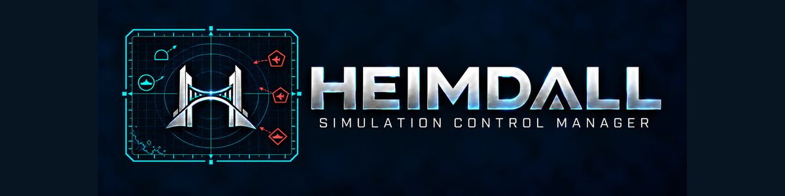

# HEIMDALL



HEIMDALL — Simulation Control Manager replaces DCS-IPIA. See the [branding and upgrade guide](docs/heimdall-branding.md) and [unreleased changes](release/UNRELEASED.md).
[HEIMDALL artwork and asset guide](src/Heimdall.App/Branding/PROVENANCE.md).

## Initial Free Edition

The initial release supports the reviewed Thrustmaster catalog with a fixed Navy-Amber photographic appearance. Premium is planned for additional supported hardware, live input testing and appearance customization; **availability and pricing TBA**. There is no checkout or subscription in this release. Existing data and saved appearance preferences are retained.

See the [Free Edition and owner activation guide](docs/design/free-edition.md), launch issue #253 and Premium roadmap #252. Public release remains subject to the licensing/distribution review recorded there.

## Game and simulator selection

Choose **DCS World** or **Elite Dangerous** on the opening cards, or continue the
last saved profile. Compact workspace selectors support guarded game/profile
switching. The Elite workspace connects native import, assignments, shared
hardware drawings, save/reopen, input feedback and review/reference exports to
the ED adapter. See the [game workspace guide](docs/design/game-workspaces.md)
for supported operations, edition boundaries and manual in-game acceptance.

## Compact workspace interactive mockup

The shipped workspace uses top feature tabs, a split Assignments editor and persistent Fit/zoom/layout preferences. See [workspace behavior and display acceptance](docs/design/compact-workspace.md). Explore the original design direction in the
[whole-workspace interactive mockup](docs/design/workspace-layout-concepts/workspace-interactive.html).
[Download the mockup](https://github.com/ScottyMac52/DCS-IPIA/raw/refs/heads/main/docs/design/workspace-layout-concepts/workspace-interactive.html)
and open the downloaded HTML file in Edge, Chrome, or Firefox; GitHub's source
viewer does not run it. No installation or server is required.

All eight feature tabs are interactive. Try sample assignments and drag-and-drop,
modifier editing, simulated input testing, page and documentation editing, Undo,
and simulated Save. Palette, panel width, selected tab, and zoom preferences are
retained when browser storage is available. Sample content is held in memory.
The prototype uses schematic artwork and illustrative behavior; it does not
connect to controllers, DCS, or the application database, and is not a feature
specification. See [enhancement #264](https://github.com/ScottyMac52/DCS-IPIA/issues/264)
and the [concept images and design notes](docs/design/workspace-layout-concepts/README.md).

## Test and coverage reports

See [the local test guide](tests/README.md) for prerequisites, each PowerShell
script's purpose, the recommended run order, output locations and troubleshooting.

Each CI run publishes a **Publish test results, coverage, and CRAP scores** job
summary and a `code-coverage-report` artifact, retained for 30 days. Download the
artifact from the run's Summary page (or the link in the reporting job), extract
it, and open `report/index.html` for source-line and branch coverage by assembly
and class. The artifact also includes raw Cobertura/OpenCover XML, Linux and
Windows TRX results, coverage JSON/CSV, `crap-scores.csv`, `crap-scores.json`, and
`test-results.json` with test counts, durations, failure messages and stack traces.

The run summary lists the highest 20 method CRAP scores and the number at or above
30. CRAP combines Coverlet's IL-derived method complexity with method line
coverage: `complexity² × (1 − coverage fraction)³ + complexity`. These scores
include compiler-generated methods. The separate consumer quality gate enforces
CRAP ≤ 50 for methods in the seven measured production assemblies. The independent **80% line / 80% branch gates for every included
assembly** remain enforced by the shared workflow. Linux and Windows test counts
are displayed as separate runs, rather than counting the same tests twice.

Reporting runs after test or coverage-gate failures and preserves available
diagnostics. A build failure may leave no test or coverage files; the reporting
summary then explicitly identifies unavailable data. Cancelled runs cannot
guarantee publication. Reports are attached to Actions runs, not GitHub Pages.

DCS Input Profile Importer Application authors and builds DCS profiles, hardware layouts, UI Layer assignments, documentation, kneeboards and OvGME packages from local SQLite state and portable snapshots. The published installer includes the database-backed editor and compact workspace. Existing consumer repositories and historical releases remain preserved; replacing a particular consumer workflow requires its own measured review.

Start with the [documentation index](docs/README.md), [edition availability](docs/design/free-edition.md), [release notes](release/RELEASE-NOTES.md) and [tested-release process](docs/application-release.md). The current documented release baseline is **v1.1.1.0**; [GitHub Releases](https://github.com/ScottyMac52/DCS-IPIA/releases) lists published versions. `main` can include later unreleased changes.

## Visual Studio

Open `HEIMDALL.sln` in Visual Studio 2026 with the .NET desktop development workload and .NET 10 SDK. The solution includes the WPF application, supporting libraries, and tests. Build the solution and run tests from Test Explorer.

## Module workspace

On Windows, run `dotnet run --project src/Heimdall.App/Heimdall.App.csproj -c Release`.

- Choose **New module** to author a module using internal hardware and a pinned shared-default revision, or **Import module sources** to read a committed consumer checkout or Saved Games profiles. Shared assets ship with HEIMDALL; the normal workflow does not require a DCS-Common checkout. Imported repositories remain read-only.
- Select a saved module and **Open module** to reopen SQLite state. Devices, Modifiers, Assignments, Commands and Pages edit one module, including its isolated UI Layer scope. Shared defaults have their own versioned workspace.
- Load command catalogs from IPI JSON or DCS HTML, edit assignments, labels, axis tuning and summary cards, then **Save to database** or **Discard draft**. The Kneeboards tab generates pages from saved state; draft preview shows current staged edits.
- Choose a **Saved Games DCS Folder** with **Browse…**, select a saved module and use **Fly Now!** to install its aircraft/UI Layer profiles and kneeboards directly. One module remains active until **Clear**, beside **Restore module snapshot…**, removes its exact copied files. See [Fly Now and Clear](docs/fly-now.md).
- Enter a package version and **Validate saved module**, **Export module snapshot…** or **Build OvGME package…**. **Restore module snapshot…** inserts verified exported state without replacing an existing module identity. See [module authoring](docs/module-authoring.md) and [new-module creation](docs/new-module-creation.md).
- Diagnostics, Sources and read-only Import details expose errors and source evidence.

## Interactive training

Choose **Help → Training / Guided workflows…** to watch the real application
create a module from scratch or import a supplied DCS Saved Games configuration.
Pause to read, advance one step, restart, or adjust playback speed. Sample data
and outputs use an isolated temporary database; your configuration stays unchanged.
Training is free on current `main` (unreleased after v1.1.1.0). Both lessons demonstrate Premium capabilities with fictional hardware and simulated input without changing your normal edition. The published v1.1.1.0 lessons still require Owner activation. See [interactive training](docs/interactive-training.md).

## Migration and OvGME status

The app validates and generates native aircraft/UI Layer Lua, device and summary PNGs, and a deterministic consumer-layout OvGME ZIP from frozen saved inputs. Portable snapshots preserve editor state and pinned assets across empty-database restore. Every package is independently verified before writing its ZIP and separate checksum.

The [pinned Step 4 capability inventory](docs/migration/dcs-common-capabilities.md) is historical evidence against its named implementation baseline, not a current backlog. Migration issues #83 and #9 are closed. The [application completion record](docs/migration/application-completion.md) describes the delivered scope; legacy repository scaffolding/cutover is separate operational work. Current real-controller/DCS, upgrade/recovery, usability and distribution acceptance is tracked in [#245](https://github.com/ScottyMac52/DCS-IPIA/issues/245) and [distribution readiness](docs/distribution-readiness.md). Passing automated builds does not establish every controller’s in-game behavior.

[Hardware SVG authoring](docs/drawio-hardware-workflow.md) uses HEIMDALL-owned draw.io tooling to verify all bundled hardware graphics or export edits into a new staging folder. No Common checkout is required; the installed application does not require Node.

## Build

```powershell
dotnet restore HEIMDALL.sln
dotnet build HEIMDALL.sln --configuration Release --no-restore
dotnet test HEIMDALL.sln --configuration Release --no-build
```

Read [CONTRIBUTING.md](CONTRIBUTING.md), [the architecture](docs/architecture/README.md), [the glossary](docs/architecture/terminology.md), and [ADR-001](docs/adr/0001-local-sqlite-and-immutable-snapshots.md).

CI requires restore, formatting, build, and tests. Every measured production assembly must independently retain at least 80% line and branch coverage.

See [coverage and CRAP gates](docs/development/quality-gates.md) for independent 80/80 output, the enforcing CRAP ceiling, and local verification commands.
