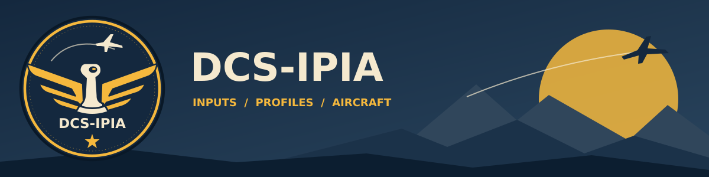

# DCS-IPIA



[Flight Patch artwork and asset guide](src/Dcs.Ipia.App/Branding/PROVENANCE.md).

## Initial Free Edition

The initial release supports the reviewed Thrustmaster catalog with a fixed Flight Patch/Navy-Amber photographic appearance. Premium is planned for additional supported hardware, live input testing and appearance customization; **availability and pricing TBA**. There is no checkout or subscription in this release. Existing data and saved appearance preferences are retained.

See the [Free Edition and owner activation guide](docs/design/free-edition.md), launch issue #253 and Premium roadmap #252. Public release remains subject to the licensing/distribution review recorded there.

## Test and coverage reports

See [the local test guide](tests/README.md) for prerequisites, each PowerShell
script's purpose, the recommended run order, output locations and troubleshooting.

Each CI run publishes a **Publish test results, coverage, and CRAP scores** job
summary and a `code-coverage-report` artifact, retained for 30 days. Download the
artifact from the run's Summary page (or the link in the reporting job), extract
it, and open `report/index.html` for source-line and branch coverage by assembly
and class. The artifact also includes raw Cobertura/OpenCover XML, Linux and
Windows TRX results, coverage JSON/CSV, `crap-scores.csv`, `crap-scores.json`, and
`test-results.json` with test counts, durations, failure messages and stack traces.

The run summary lists the highest 20 method CRAP scores and the number at or above
30. CRAP combines Coverlet's IL-derived method complexity with method line
coverage: `complexity² × (1 − coverage fraction)³ + complexity`. These scores
include compiler-generated methods. The separate consumer quality gate enforces
CRAP ≤ 50 for methods in the six measured production assemblies. The independent **80% line / 80% branch gates for every included
assembly** remain enforced by the shared workflow. Linux and Windows test counts
are displayed as separate runs, rather than counting the same tests twice.

Reporting runs after test or coverage-gate failures and preserves available
diagnostics. A build failure may leave no test or coverage files; the reporting
summary then explicitly identifies unavailable data. Cancelled runs cannot
guarantee publication. Reports are attached to Actions runs, not GitHub Pages.

DCS Input Profile Importer Application is the future data-driven authoring and build boundary for DCS profiles, hardware, UI Layer assignments, documentation, kneeboards, and OvGME packages. Existing DCS-Common and consumer pipelines remain authoritative until each module passes equivalence and receives explicit approval. The current published installer predates the database-backed assignment editor and simplified navigation; use current `main` to review those changes.

## Visual Studio

Open `DCS-IPIA.sln` in Visual Studio 2026 with the .NET desktop development workload and .NET 10 SDK. The solution includes the WPF application, supporting libraries, and tests. Build the solution and run tests from Test Explorer.

## Module workspace

On Windows, run `dotnet run --project src/Dcs.Ipia.App/Dcs.Ipia.App.csproj -c Release`.

- Choose **New module** to author a module using internal hardware and a pinned shared-default revision, or **Import module sources** to read a committed consumer checkout or Saved Games profiles. Shared assets ship with IPIA; the normal workflow does not require a DCS-Common checkout. Imported repositories remain read-only.
- Select a saved module and **Open module** to reopen SQLite state. Devices, Modifiers, Assignments, Commands and Pages edit one module, including its isolated UI Layer scope. Shared defaults have their own versioned workspace.
- Load command catalogs from IPI JSON or DCS HTML, edit assignments, labels, axis tuning and summary cards, then **Save to database** or **Discard draft**. The Kneeboard tab generates pages from saved state; draft preview shows current staged edits.
- Choose a **Saved Games DCS Folder** with **Browse…**, select a saved module and use **Fly Now!** to install its aircraft/UI Layer profiles and kneeboards directly. One module remains active until **Clear**, beside **Restore module snapshot…**, removes its exact copied files. See [Fly Now and Clear](docs/fly-now.md).
- Enter a package version and **Validate saved module**, **Export module snapshot…** or **Build OvGME package…**. **Restore module snapshot…** inserts verified exported state without replacing an existing module identity. See [module authoring](docs/module-authoring.md) and [new-module creation](docs/new-module-creation.md).
- Diagnostics, Sources and read-only Import details expose errors and source evidence.

## Interactive training

Choose **Help → Training / Guided workflows…** to watch the real application
create a module from scratch or import a supplied DCS Saved Games configuration.
Pause to read, advance one step, restart, or adjust playback speed. Sample data
and outputs use an isolated temporary database; your configuration stays unchanged.
See [interactive training](docs/interactive-training.md).

## Migration and OvGME status

The app validates and generates native aircraft/UI Layer Lua, device and summary PNGs, and a deterministic consumer-layout OvGME ZIP from frozen saved inputs. Portable snapshots preserve editor state and pinned assets across empty-database restore. Every package is independently verified before writing its ZIP and separate checksum.

The [pinned Step 4 capability inventory](docs/migration/dcs-common-capabilities.md) records all remaining Common authored tooling, documentation, consumer scaffolding and Complete-release gaps. Snapshot rebuild success does not establish full published-consumer parity or manual DCS success. [#83](https://github.com/ScottyMac52/DCS-IPIA/issues/83) and [roadmap #9](https://github.com/ScottyMac52/DCS-IPIA/issues/9) retain those acceptance gates. Existing consumers remain authoritative until their measured parity and rollback decisions are approved.

[Hardware SVG authoring](docs/drawio-hardware-workflow.md) uses IPIA-owned draw.io tooling to verify all twelve published hardware graphics or export edits into a new staging folder. No Common checkout is required; the installed application does not require Node.

## Build

```powershell
dotnet restore DCS-IPIA.sln
dotnet build DCS-IPIA.sln --configuration Release --no-restore
dotnet test DCS-IPIA.sln --configuration Release --no-build
```

Read [CONTRIBUTING.md](CONTRIBUTING.md), [the architecture](docs/architecture/README.md), [the glossary](docs/architecture/terminology.md), and [ADR-001](docs/adr/0001-local-sqlite-and-immutable-snapshots.md).

CI requires restore, formatting, build, and tests. Every measured production assembly must independently retain at least 80% line and branch coverage.

See [coverage and CRAP gates](docs/development/quality-gates.md) for independent 80/80 output, the enforcing CRAP ceiling, and local verification commands.
