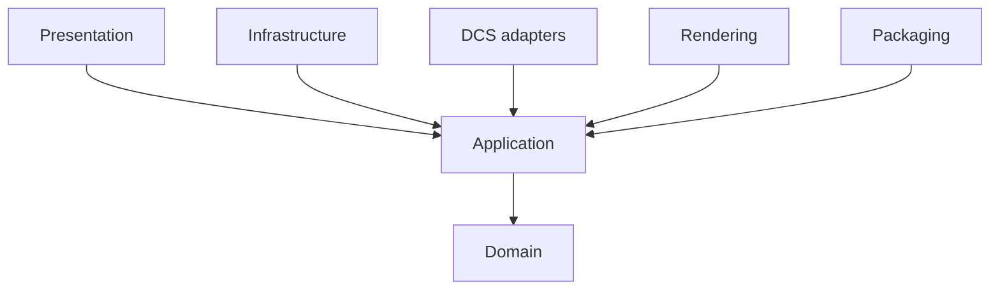

# Architecture

Dependencies point inward. Domain owns entities and invariants. Application owns use cases and ports. Infrastructure implements persistence. DCS, rendering, and packaging are replaceable adapters. Presentation stays thin and accesses data only through application use cases.

Local SQLite is authoritative interactive state. Canonical snapshots are the review, CI, release, rollback, and interoperability boundary. Generated documentation, images, Lua, and packages are replaceable outputs.

Phase 0 provides a module CRUD seam, transactional migration, verified backup, and deterministic snapshot/render/package primitives. It is foundation code, not a claim of Huey or DCS-Common parity.
