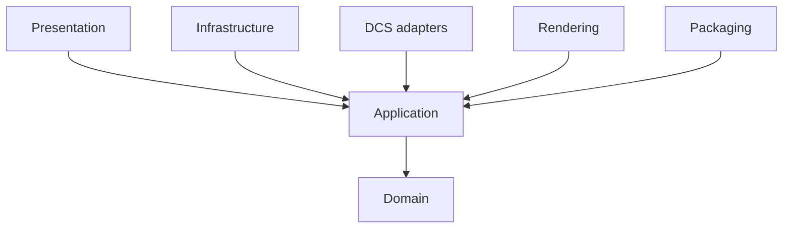

# Architecture

Dependencies point inward. Domain owns entities and invariants. Application owns use cases and ports. Infrastructure implements persistence. DCS, rendering, and packaging are replaceable adapters. Presentation stays thin and accesses data only through application use cases.

Local SQLite is authoritative interactive state. Canonical snapshots are the review, CI, release, rollback, and interoperability boundary. Generated documentation, images, Lua, and packages are replaceable outputs.

The application now includes module/shared-default authoring, inventory/setup, custom drawings, live testing, guided training, verified recovery and snapshot-driven outputs, subject to [edition policy](../design/free-edition.md). SQLite migration version is 10; configuration snapshots, editor payloads, portable module snapshots, backups and appearance preferences have separate version contracts. The original schema-v1 documents are historical contracts, not the current database schema. See [module authoring](../module-authoring.md), [database operations](../operations/database.md) and [application completion](../migration/application-completion.md).
