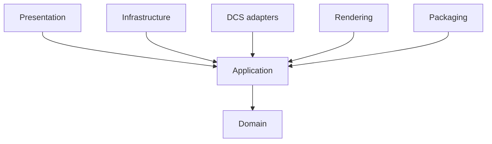

# Architecture

Dependencies point inward. Domain owns entities and invariants. Application owns use cases and ports. Infrastructure implements persistence. DCS, rendering, and packaging are replaceable adapters. Presentation stays thin and accesses data only through application use cases.

Local SQLite is authoritative interactive state. Canonical snapshots are the review, CI, release, rollback, and interoperability boundary. Generated documentation, images, Lua, and packages are replaceable outputs.

The application now includes module/shared-default authoring, inventory/setup, custom drawings, live testing, guided training, verified recovery and snapshot-driven outputs, subject to [edition policy](../design/free-edition.md). SQLite migration version is 10; configuration snapshots, editor payloads, portable module snapshots, backups and appearance preferences have separate version contracts. The original schema-v1 documents are historical contracts, not the current database schema. See [module authoring](../module-authoring.md), [database operations](../operations/database.md) and [application completion](../migration/application-completion.md).

Workspace inheritance and the DCS implementation are described in [workspace window inheritance](workspace-window-inheritance.md), including the base algorithms, override hooks, ownership boundaries and migration acceptance.

See [DCS type naming](dcs-type-naming.md) for the DCS ownership naming rules, rename inventory and persisted-identity compatibility.

Native consumers are detailed in [ED workspace inheritance](elite-workspace-inheritance.md) and [Squadrons workspace inheritance](squadrons-workspace-inheritance.md).

See [game presentation ownership](game-presentation-ownership.md) for ED and Squadrons folder/namespace boundaries and compatibility rules.

The final native consumer is described in [War Thunder workspace inheritance](war-thunder-workspace-inheritance.md).

The proposed completion of the workspace collaborator contracts is specified in [ADR-0002](../adr/0002-enforced-game-workspace-role-contracts.md). Read the [exact role APIs and shared algorithms](workspace-role-contracts.md), [pinned source inventory and native migration map](workspace-role-migration.md), and [reusable/native acceptance design](workspace-role-acceptance.md). These documents are the specification for issue #357; they do not claim that the role migrations have been implemented.

Issue #357 PR 2 implements the [shared workspace contexts](workspace-context-implementation.md), with one state/operation authority across all four native adapters. Other collaborator roles remain scheduled in the issue.
