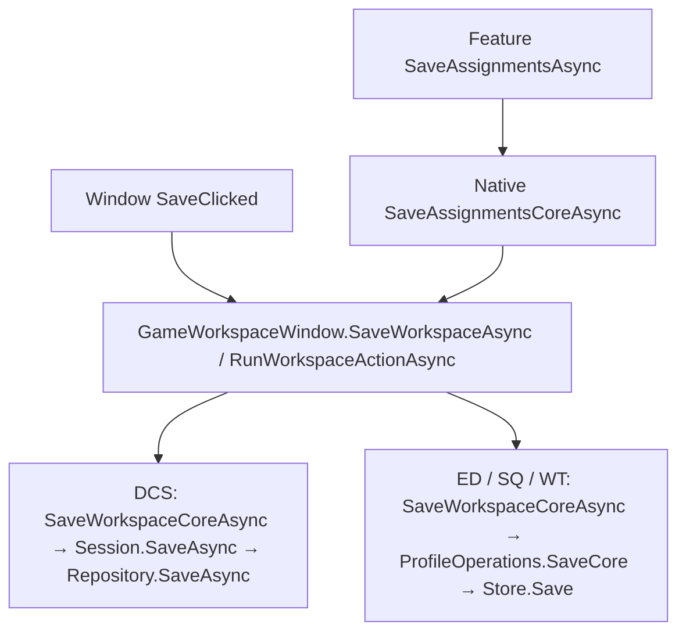
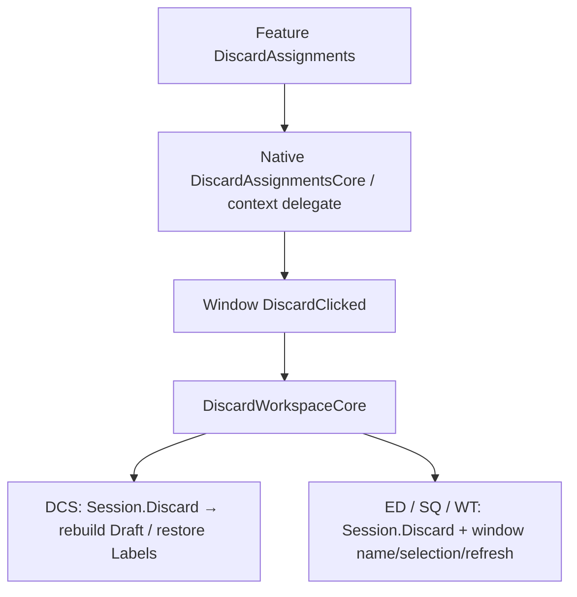
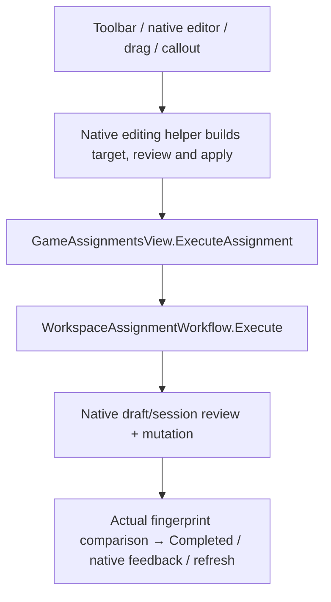
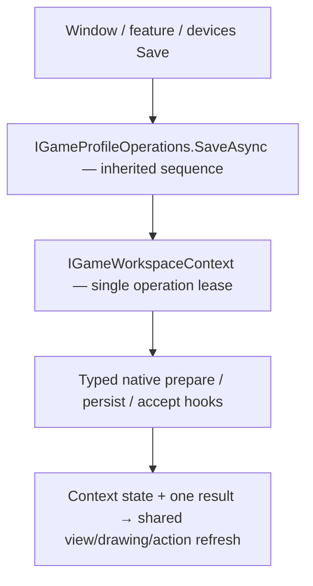

# Workspace role source audit and migration map

Baseline: main `0fa0e28b8e50c23d57a3d14b4d47d35b7c1d3db0`, after merged #356. This is a design audit for [ADR-0002](../adr/0002-enforced-game-workspace-role-contracts.md), not a claim that the proposed contracts exist. See [exact APIs](workspace-role-contracts.md) and [acceptance](workspace-role-acceptance.md). Recheck main and record inventory deltas in each implementation PR.

## Pinned inventory

The following indexes cover 106 source/XAML files, including the existing shared algorithms, interfaces and native role implementations. Each entry records the original Git blob ID, source line count, declaration line/signature and XAML event/name wiring. This is a lexical locator index, not a semantic compiler report: anonymous callbacks, inferred members and method bodies require reading the pinned source. The manually audited call paths and state ownership below complement it. The inventory is a baseline record, not a test that freezes future file names.

| Index | Files | Scope |
| --- | ---: | --- |
| [Shared](workspace-role-inventory/shared.json) | 27 | Window/assignments bases, services, workflow, selection, input/drawing helpers and ports |
| [DCS](workspace-role-inventory/dcs.json) | 27 | Root window/context/view model/selection, session/features/output, assignments/devices/commands and native context/repository ports |
| [Elite](workspace-role-inventory/elite.json) | 23 | Native context, all collaborators, views, tuning/output/reference helpers |
| [Squadrons](workspace-role-inventory/squadrons.json) | 12 | Native context, all collaborators and views |
| [War Thunder](workspace-role-inventory/war-thunder.json) | 17 | Native context, all collaborators, native editor/tuning/review views |

To resolve a locator, use `https://github.com/ScottyMac52/DCS-IPIA/blob/0fa0e28b8e50c23d57a3d14b4d47d35b7c1d3db0/<path>#L<line>`. The audit scope is workspace orchestration and its direct ports; parser/repository internals and the rest of DCS's feature suite are not reclassified as shared UI roles.

## Existing state and event owners

| Current owner | State / entry points at baseline | Migration decision |
| --- | --- | --- |
| `GameWorkspaceWindow` | `_runningAction`, `_confirmingLeave`, `_closed`; feature/cache/cleanup; RunWorkspaceActionAsync, SaveWorkspaceAsync, DiscardClicked, ConfirmWorkspaceLeaveAsync | Keep feature/cache/lifetime/prompt ownership; replace independent action gate with context/profiles |
| `GameAssignmentsView` | Own selection + workflow; `_saving`, `_refreshing`, mounted/subscription flags; SaveAssignmentsAsync, DiscardAssignments, ExecuteAssignment | Context owns selection/workflow/save state; keep only view refresh/mount/subscription guards |
| `EliteWorkspaceContext` | Session, Revision, Refreshing, Commands/Rows; selection and Func selectors for device/name/section/feature/busy/testing/identifying; Changed/NotifyChanged | Derive context base; move authoritative selected/name/operation state into it; typed session and projection caches remain native |
| `SquadronsWorkspaceContext` | Session/Revision, SourceDirectory, Drawings/Rows, ControllerInputs, FocusedConcept/InspectedControl; Refreshing/ScanningInputs/Disposed; Busy/Testing/Identifying delegates; Changed | Derive base; replace workspace flags/delegates with context operation/activity; keep typed source and inspector/projection state |
| `WarThunderWorkspaceContext` | Session/Revision, Drawings/Observed/ControllerInputs/Rows, PhysicalMap, SelectedPhysicalInput, DrawingAssignments; Refreshing/ScanningHardware/Disposed/Busy/Testing; Changed | Derive base; physical evidence/cache native; operation/activity/selection authoritative in base |
| `DcsWindowContext` | Facade over session; injected Save/Discard delegates; IDcsModuleWorkspaceContext | Replace with DcsWorkspaceContext inheritor; compatibility facade only until PR 9, no second session |
| `DcsWorkspaceSession` | Saved/Working/Draft/Labels, `_structureDirty`, `_saving`, `_disposed`; StateChanged/StatusChanged; SetLabel, RunStructureEdit, SaveAsync, Discard, SetDraft/DraftChanged | Retain native snapshot/draft/labels/validation/repository port; move common operation/event/dirty orchestration to context/profiles; native draft events adapted once |
| Controller presenters / drawing/input helpers | Native scans/evidence, `Input`, feedback handlers, identifiers and lifetime resources; disposal independently coordinated | Controller base owns common acquisition/lease/generation/cleanup sequence; native hook owns native resource construction only |
| Views/windows/profile collaborators | Repeated Refresh, status, Run/RunBusy and save callbacks | Interface-based composition; one feedback path per admitted action; local control-population guards remain local |

Native dirty sources remain authoritative for native edits: DCS structural flag/draft/label comparison; other games' session changes/new workspace. Base derives overall dirty plus edited name and publishes it; it does not duplicate a native diff or change revision semantics. Native state cannot read controls to decide current workspace identity or busy state.

## Current call paths and duplicate sequences

These diagrams show baseline behavior, not the proposed final interfaces. Each native box names the actual method, with its source indexed above.

DCS feature delegates flow through `DcsWindowContext.SaveAsync`; other games bind window Save delegates to assignments. DCS session suspends draft editing, composes labels/assignments, validates edition/UI-layer recovery/integration and awaits repository before rebuilding saved baseline. ED/SQ/WT SaveCore build a candidate, save with native revision, then accept the session/name/revision. These native transactions remain. Duplicate common sequences are window action gating + view saving gate + native/session busy checks; native profile validation/prepare/write/accept/refresh/report; window/feature save feedback and repeated redraw/action-availability refresh. Extract these sequences, not their native validation rules.

Restore baseline, reset editor/name, stop input, refresh browser/drawing/actions and notify are repeated across native windows and helpers. They move to the profile template with native atomic restore. DCS restore additionally replaces a subscribed draft; PR 2 must adapt its events without leaving the old draft subscribed.

DCS AssignWithConfirmation/Clear/ClearLayer/Undo/TuneAxis and native labels/drag helpers use native draft slots; ED ExecuteAssignment wraps reviewed GameAssignmentEdit; SQ StageAssignment/ExecuteNativeAssignment handles SquadronsCommandEdit; WT ExecuteAssignment accepts WarThunderNativeEdit. Same-target actual-change, stale review and gates already belong to the existing workflow. Native feedback/action refresh, controller-input selection and invalidation are duplicated around it. Keep the workflow; move orchestration to editing base. DCS's baseline CaptureAssignmentContext currently reports read-only/busy/testing as false; the migration must use real context gates rather than preserve that gap.

Other repeated sequences identified by the audit: browser catalog/query/filter/preserve/refresh; drawing render/selection/action state; scan/stop input/clear evidence/review link/refresh; devices populate/selection/availability/unload; session subscription/change/status/dispose; profile load/import replacement/leave/recent selection. These are the functions assigned to the corresponding bases in the contract document. Native filters/projections and parser/export algorithms remain native. This inventory does not require extracting each private helper simply because it has a counterpart name.

## Final contract/base/native class map

Each cell identifies an actual native inheritor to implement, not a game-specific copy of the base sequence. Generic arguments below bind native DTO families; browser filter/drawing projection DTOs are named here as new native immutable records whose fields are specified under native extensions. The full mandatory hook sets are in the API specification and must be overridden by each named class. Existing class names are retained where already accurate.

| Contract and base | DCS | ED | Squadrons | War Thunder |
| --- | --- | --- | --- | --- |
| `IGameWorkspaceContext<TSnapshot>` / `GameWorkspaceContextBase<TSnapshot>` | `DcsWorkspaceContext : GameWorkspaceContextBase<DcsEditorWorkspaceSnapshot>` | `EliteWorkspaceContext : GameWorkspaceContextBase<GameWorkspace>` | `SquadronsWorkspaceContext : GameWorkspaceContextBase<GameWorkspace>` | `WarThunderWorkspaceContext : GameWorkspaceContextBase<GameWorkspace>` |
| `IGameProfileOperations` / `GameProfileOperationsBase<TSnapshot,TCommit>` | `DcsProfileOperations` with native snapshot and `DcsSaveReceipt` | `EliteProfileOperations`, GameWorkspace / store revision string | `SquadronsProfileOperations`, GameWorkspace / store revision string | `WarThunderProfileOperations`, GameWorkspace / store revision string |
| `IGameAssignmentBrowser<TCommand,TRecord,TFilter>` / corresponding base | `DcsAssignmentBrowser`, DcsCommandPaletteEntry / DcsDraftAssignment / DcsBrowserFilter | `EliteAssignmentBrowser`, SimCommand / EliteAssignmentRow / EliteBrowserFilter | `SquadronsAssignmentBrowser`, SimCommand / SquadronsWorkspaceRow / SquadronsBrowserFilter | `WarThunderAssignmentBrowser`, SimCommand / WarThunderWorkspaceRow / WarThunderBrowserFilter |
| `IGameAssignmentEditing` / `GameAssignmentEditingBase` | `DcsAssignmentEditing` | `EliteAssignmentEditing` | `SquadronsAssignmentEditing` | `WarThunderAssignmentEditing` |
| `IGameAssignmentDrawing` / `GameAssignmentDrawingBase<TDrawing>` | `DcsAssignmentDrawing`, DcsDrawingProjection | `EliteAssignmentDrawing`, EliteDrawingProjection | `SquadronsAssignmentDrawing`, SquadronsDrawingProjection | `WarThunderAssignmentDrawing`, WarThunderDrawingProjection |
| `IGameControllerPresenter` / `GameControllerPresenterBase<TObservation,TLink>` | `DcsControllerPresenter`, DcsControllerObservation / DcsControllerLinkPlan | `EliteControllerPresenter`, EliteControllerObservation / GameControllerChange | `SquadronsControllerPresenter`, SquadronsControllerObservation / GameControllerChange | `WarThunderControllerPresenter`, WarThunderControllerObservation / GameControllerChange |
| `IGameDevicesView` / `GameDevicesView` | `DcsDevicesView` | `EliteDevicesView` | `SquadronsDevicesView` | `WarThunderDevicesView` |
| Existing window / assignments bases | `DcsModuleWorkspaceWindow`, `DcsAssignmentsView` | `EliteWorkspaceWindow`, `EliteAssignmentsView` | `SquadronsWorkspaceWindow`, `SquadronsAssignmentsView` | `WarThunderWorkspaceWindow`, `WarThunderAssignmentsView` |

Native context classes close the shared generic base; they are not themselves generic. `DcsDraftAssignment` is the existing native assignment record. Its command/profile/layer address is projected by the browser hook without a lossy cast or row-index identity. Any later API change must update this specification and acceptance in the same reviewed PR; it cannot become an `object` workaround.

## Exact native bindings for required hooks

This table closes every abstract hook group against concrete native behavior. Base hook names/sequences are normative in the contract document; grouped names here refer to that complete hook set. All native role ports are constructor-injected interfaces. Native child control references remain only in native presentation code.

| Hook group | DCS override / injected behavior | ED override / injected behavior | Squadrons override / injected behavior | War Thunder override / injected behavior |
| --- | --- | --- | --- | --- |
| Context ReadNativeFacts / ReadWorking / ReadSaved / fingerprint / name / dispose | Session module ID, structural/draft/labels + edition/training/access; canonical EditSnapshot including labels; native module naming; draft detach | Session Workspace ID, AccessMessage, HasChanges/new/name and revision; native canonical GameWorkspace capture; native name rules; session detach | Session ID, system source readonly, new/name/native changes; canonical records/slots/source fingerprint; session detach | Session ID/access/name/native changes; canonical occurrence/BLK/input parameter fingerprint; session detach |
| Profile PrepareSave / Persist / Accept / Restore | Existing EditSnapshot; edition → pinned UI-layer recovery → validation → integration checks; repository SaveAsync; DcsSaveReceipt(snapshot); rebuild draft/labels baseline; atomic restore Saved | Existing SaveCore candidate/name validation; Store.Save(candidate, revision); revision receipt + prepared replacement session (baseline currently uses OpenSession); Session.Discard + name reset | SaveCore candidate with slot/source metadata; Store.Save revision; accept saved name/revision; discard native session + editor reset | SaveCore candidate preserving native records/parameters; Store.Save revision; accept native baseline/name/revision; discard/clear physical selection cache |
| Profile refresh / wording | Native feature availability, assignments/browser/drawing invalidation; DCS database wording | Existing RefreshEntries/Refresh and reference invalidation; saved profile wording | ReloadChoices/Remember/browser/drawing; saved profile wording | RefreshEntries/Remember/browser/drawing; saved profile wording |
| Browser ReadCommands/Records + ID + filters + selection mappings | CommandManager native catalog; module/UI-layer, axis/category/bound filters; IDs + profile/layer/draft address map | FilterCommands/SelectRow; SimCommand ID and Elite row identity, category/type/section/slot filters; exact primary/secondary/axis address | RefreshCommandCatalog/RefreshRows/SelectRecord; command concept + native slot/record identity, capture/source filters; no declaration reordering | RefreshCommands/RefreshRecords; native command ID + occurrence address, search/device/type filters; repeated records retain distinct IDs |
| Editing ReadNativeSupport / RefreshNativeEditor / ReportNativeResult; operation builders | Existing Assign/Clear/ClearLayer/Undo/TuneAxis and label/drag operations; Inspector; selected native profile/layer and reserved modifiers | Existing Draft/Review/Apply/Clear with combination inputs/invert/deadzone; LoadAssignment/UpdateAvailability; AssignmentFeedback | StageAssignment, ExecuteNativeAssignment, reverse pair/tuning, native record clear; UpdateEditor/UpdateApplyAvailability; AssignmentFeedback | WarThunderNativeEdit, physical clear choices/chords/tuning; RefreshEditor/RefreshInputState; native result feedback |
| Drawing project / present / actions / input-map / interaction lifetime | DcsAssignmentDiagram + Preview + labels; native drawing inputs map to profile/layer/draft slots; existing drag/viewport and interaction detach | Existing drawing/reference/artwork projection + shared presenter; native input keys/slot selection; existing interactions | Existing drawing projection plus paired axes/concept/record labels; physical link evidence; attach/detach existing interactions | Existing physical-map/occurrence/chord labels and presenter; choice menus and selected native input; attach/detach existing interactions |
| Controller discovery/projection/start/review-link/release | Discovery/capabilities/training/inventory; native GUIDs and reviewed mapping adoption/rebind; DCS input source and cleanup | Services discovery + device-reference matcher; replacement/removal review; native link/identity policies; Input + feedback lifetime | Logical slot identity independent physical match; verified observations; native slot link review; Input + feedback lifetime | Controller index/range + verified physical map; native joystick review/replacement, no index inference; Input + feedback lifetime |
| Devices populate / availability | Existing managed-device details/structure/inventory native panels; common controller commands | Existing device details/native reference warnings + common controller commands | Existing source/slot details, readonly/unverified explanation + common commands | Existing native device details/ambiguity explanation + common commands |

### Typed native ports and DTO boundaries

Context native extension interfaces (`IDcsWorkspaceContext : IGameWorkspaceContext<DcsEditorWorkspaceSnapshot>`, `IEliteWorkspaceContext`, `ISquadronsWorkspaceContext`, `IWarThunderWorkspaceContext` extending `IGameWorkspaceContext<GameWorkspace>`) expose a read-only typed `Session` port and native projection/input properties, not writable common state. Existing `IDcsModuleWorkspaceContext` is a compatibility extension of IDcsWorkspaceContext until PR 9; SetLabel/RunStructureEdit and DCS-specific pickers/training services remain native typed methods and delegate to the same authority.

Every native session port supports exact profile calls `TSnapshot PrepareSave(string editedName)`, `Task<WorkspaceCommit<TSnapshot,TCommit>> PersistAsync(TSnapshot candidate, CancellationToken token)`, `void AcceptCommit(WorkspaceCommit<TSnapshot,TCommit> commit)`, `void RestoreSaved()`, `string CaptureFingerprint()`, read-only `Working`, `Saved`, `NativeWorkspaceFacts Facts`, and `event EventHandler? Changed`. Methods are typed by native snapshot/receipt, declared on narrow native interfaces at the adapter edge. Persist implements native transaction rules; Accept/Restore trigger the context adapter's protected session transition, not a second busy gate. DCS snapshot/label/structure extra methods are added only to its port. `DcsSaveReceipt` is `record(DcsEditorWorkspaceSnapshot SavedSnapshot)`; store revisions use existing `string`. No DCS revision string is invented. Typed optional profile commands use native request/result records already used by backend operations, wrapped only where picker/user cancellation needs an explicit result.

New filter DTOs are native records: DCS `(AssignmentLayer Layer, string? Category, bool? IsAxis, bool? Bound)`; ED `(string Section, string? Category, CommandType? Type, string Slot)`; SQ `(string? Source, string? DeviceId, string Section, string? Category, CommandType? Type, bool CaptureReview)`; WT `(string? DeviceId, string? Category, CommandType? Type)`. Search is base-owned. No native filter enters shared code except as `TFilter` passed back to a typed predicate. Native row payloads remain native; stable string IDs are the common locator only. New drawing projections carry native typed artwork, callouts, labels and address maps; they are private adapter DTOs, not a universal model with optional fields for each game. Controller observation DTOs pair existing `DetectedDcsDevice` and `ControllerObservation` evidence with the native logical-link keys and readonly native evidence; no common role interprets a native product token.

### Service split

Keep shared store/recent-choice/discovery/hardware behavior behind interfaces injected as needed; common bases never receive the existing broad `GameWorkspaceServices`. In PR 3 introduce `IEliteWorkspaceServices` at the native adapter edge with `EliteDangerousProfileBackend Backend { get; }` and `EliteDeviceReferenceMatcher DeviceReferences { get; }`. Move those two properties out of GameWorkspaceServices once all native call sites are converted. ED profile/controller adapters receive it explicitly; SQ/WT/DCS do not. Existing `IGameWorkspaceStore`, `IConnectedDeviceDiscovery`, `IControllerCapabilityDiscovery` remain ports. Shared recent-choice methods can retain their current best-effort preference failure policy. Bundled DCS hardware loading is an App composition concern; inject the resulting catalog/provider instead of importing a DCS loader into an Application base. This is not resolved by renaming the same facade or exposing `GetService<T>()`.

## DCS source transitions and all-game PR boundaries

| PR | DCS source transition | ED / SQ / WT transition and deletion boundary |
| --- | --- | --- |
| 2 context | Add Games/Dcs/DcsWorkspaceContext; adapt DcsWindowContext/IDcsModuleWorkspaceContext to one base-owned context; session reports native facts, generation/fingerprint/events. Window/features consume common state. Keep native session/repository/draft | All three contexts derive generic base; remove delegated authoritative busy/selection/name flags; single workflow/selection from context; retain only typed native caches and view-local guards |
| 3 profiles | Add DcsProfileOperations; lift common SaveAsync/Discard sequence out of session/window; native session implements typed port. DcsWorkspaceOutput remains typed native output command; structural validation preserved | Derive each ProfileOperations from profile base; SaveCore sequences collapse to typed hooks; typed import/output command wrappers, leave routes and ED service split; remove duplicate save feedback and locks |
| 4 browser | Add DcsAssignmentBrowser; extract CommandManager browsing projection/filter/selection from DcsAssignmentsView; DcsCommandPaletteView/management remain native control/structural feature | All three browsers derive base; replace common filtering/preservation with hooks; remove concrete browser factories from consumers |
| 5 editing | DcsAssignmentEditing derives editing base; move view.Execute coordination to shared role; Inspector/Labels/DragDrop build operations/native UI, not independent gates | All three editing classes derive base; retain typed native operation builders and native editors/tuning; remove copied wrapper/feedback/actions sequence |
| 6 drawing | Add DcsAssignmentDrawing deriving base, composed from native DcsAssignmentDiagram/Preview/viewport helpers. Shared refresh/actions/input/mount sequence leaves view | All drawing classes derive base; projection hooks retain native artwork; no drawing owns physical input acquisition; preserve RefreshActions after Save |
| 7 controllers | Add DcsControllerPresenter; extract discovery/link/rebind/adoption/input lifetime from DcsDevicesView; DcsControllerSelection becomes thin rail binding adapter to interface or is removed | All presenters derive base; scan/selection/activity/link lifetime inherited; old concrete sibling factories removed, native link/index review retained |
| 8 devices | DcsDevicesView XAML root derives GameDevicesView; business logic previously extracted; native inventory/structure actions supplied as typed panels | All devices views derive WPF base and bind controller/context; common mount/layout/availability; no new native behavior hidden in code-behind |
| 9 composition | Move primary DcsModuleWorkspaceWindow/Context adapters into Games/Dcs with namespace/XAML/usings/test updates; DcsAssignmentsView + Devices primary surfaces follow ownership map; delete legacy facade and adapter callbacks; feature helpers may remain under Features only as native children | All roots construct roles then bind common interfaces; delete transitional members/factories/duplicate locks; any native sibling coupling requires narrow typed extension; no unrelated bulk rename |
| 10 independent acceptance | Audit every DCS route including non-assignment authoring, training, edition, outputs and disposal | Reusable all-game fixtures, dependency and source ownership audit, measured layout/native behavior; remove remaining dead transitional code; record accepted deviations explicitly |

PR 2 must connect context to existing bases even though their broader signature cleanup finishes in PR 9: a temporary forwarding property must expose the same context engine/gate, never create a second instance. Likewise PR 3 migrates every save/discard entry including feature/device buttons; no hidden old route remains while later roles migrate. Each PR finishes its role across four games before merging. No native feature is deleted to achieve a smaller class.

Native-only DCS helpers retained where meaningful: assignment inspector/labels/drag-drop/preview, draft and structural editors, modifier/page/command management, integration imports, training environment, package/output/recovery services. ED reference sheets/export review/modifier choices/axis tuning; SQ native record/template/paired-axis logic; WT native editor/review/compound tuning are retained. Their existence is not a contract failure; shared orchestration bypasses are.

## Final target call path

Discard follows the same role entry with atomic native restore and no write. Assignment entry is native request builder → IGameAssignmentEditing.Execute → existing context-owned workflow → native Review/Apply → existing actual-change check → common result/refresh. No save is nested in an assignment operation, and no window/feature route manufactures a second operation lease.

## PR 3 implementation notes (draft)

- Shared contracts live in `Heimdall.Application`: `IGameProfileOperations`, `IWorkspaceInputLifetime`, `WorkspaceCommit<TSnapshot,TCommit>`, `IGameProfileCommand<TRequest,TResult>`, `GameProfileOperationsBase<TSnapshot,TCommit>` (the only save/discard sequence), `GameStoreProfileOperationsBase` (optimistic-revision store hooks) and `GameProfileCommandBase<TRequest,TPrepared,TResult>`.
- Native hooks: `DcsProfileOperations` (pinned/edition-checked candidate, one repository write with draft editing suspended, draft rebuild), `EliteProfileSaving` (reopens the persisted preset model as before), `SquadronsProfileSaving` (an unsaved import discards to no session as before) and `WarThunderProfileSaving`.
- `GameWorkspaceWindow` no longer declares `SaveWorkspaceCoreAsync`/`DiscardWorkspaceCore`; its Save/Discard buttons, feature save/discard delegates and the leave guard all call `ProfileOperations`.
- Contract clarifications: `AcceptCommit` and `RestoreSaved` receive the lease because native session acceptance requires it; `RefreshAfterPersistence` receives the completed kind; status messages are read after refresh so best-effort preference failures are included; an empty native message leaves the existing status surface untouched (DCS).
- Intentional behavior changes: a clean writable save now returns NoChange without writing; a War Thunder save while input testing now stops input and saves (shared sequence) instead of rejecting.
- `IEliteWorkspaceServices` now owns the ED backend and device-reference matcher; `GameWorkspaceServices` no longer exposes them. It is the single owner-approved C# layout interface exception: exactly `internal` in `Heimdall.App.Games.Elite` at `src/Heimdall.App/Games/Elite/IEliteWorkspaceServices.cs` (`scripts/check_csharp_layout.py`, `NATIVE_EDGE_INTERFACES`).
- Typed native commands (all derive `GameProfileCommandBase<TRequest, TPlan, TResult>`; availability → admit → stop input → prepare/review → recheck lease and fingerprint → native run → accept only on success → refresh):
  - DCS: `DcsOutputCommand` (validate, package, module snapshot, documentation, complete release). Replaces `DcsWorkspaceOutput`. The destination is now picked before freeze/validation (order change: a cancelled picker no longer validates).
  - ED: `EliteImportCommand`, `EliteCreateConfigurationCommand` (session is created and validated before the store write), `EliteDeleteConfigurationCommand`, `EliteExportCommand` (reference repair completes before export admission; Prepare rechecks issues).
  - SQ: `SquadronsImportCommand`, `SquadronsNewProfileCommand`, `SquadronsExportCommand` (review output).
  - WT: `WarThunderImportCommand` (file is read and parsed before the leave prompt, so an invalid file never discards edits), `WarThunderDuplicateCommand`, `WarThunderExportCommand` (review output).
- Read-only saves (clean or dirty) are refused by context admission, which owns native restriction reasons (for example the DCS Free Edition reserved-hardware denial); the result is `Blocked` with that exact reason and no hook runs. `GameWorkspaceWindow.SaveWorkspaceAsync` returns the typed `WorkspaceOperationResult` (Applied or NoChange) and throws only for Blocked/Cancelled.
- Hot-path performance: `IGameWorkspaceContext.ContentVersion` moves only for native content or identity changes. `WorkspaceChangeObserver` is the one shared policy that classifies notifications as None, Selection, Presentation or Content. Assignment views reload only on Content; DCS feature views skip selection-only notifications. The window no longer re-reads native facts inside its own `StateChanged` handler. `GameProfileSession` caches the immutable canonical JSON of its current and saved documents per instance; the cache is dropped on every reassignment and change notification, so dirty equality stays exact. `Snapshot` still returns an independent clone. Id, name and hardware-pin reads no longer clone the document.
- `ProfileContentCache` memoizes immutable projections per session, `ContentStamp` and key. It covers WT native device records and physical maps, the ED selected device and the SQ selected controller, so selection and availability refreshes no longer clone the whole document. Id and name reads use scalar session queries.
- ED `CurrentDrawing` memoizes the selected controller's drawing per document and controller. The reviewed drawing list is fixed per context, so per-control `DrawingKey` reads no longer clone the document. The profile conformance smoke fixtures now use one counting store per game, so another game's setup writes are no longer counted as this game's writes.
- Behaviour changes: a clean save returns `NoChange`; a War Thunder save during input testing stops input and saves.
- Kept out of PR 3 by design: loading a saved profile uses the spec-allowed synchronous `Replace` admission of `ReplaceNativeSession`; Squadrons `ImportTemplatesFile` is a native draft edit (not an import or replacement); DCS structure edits belong to the context role (PR 2); ED controller-change `RunBusy` belongs to a later role. Assignment-view save/discard hooks remain a transitional route through the window entry point until PR 9.
- Smoke-risk audit: a save publishes exactly two `StateChanged` notifications (operation admission and release) because non-forced publishes are suppressed while an operation is live, including the Elite reopen-after-save path; discard after save restores the exact post-save baseline. Both are pinned by deterministic unit tests in `GameProfileOperationsTests`.

## PR3 transaction contracts (save boundary, owner thread, same-data lifecycle)

- **Save boundary.** `GameProfileOperationsBase` runs all fallible native validation in `PrepareSave` before the one durable write.
  After persistence nothing is reported as an uncommitted failure: an `AcceptCommit` failure returns `Applied`, `Committed` and
  `RecoveryRequired`; the context then blocks save, discard, edit and export on the stale session until a fresh session is
  installed (reopen/import). Any non-fatal refresh/preference failure is a warning on the committed save.
  DCS now builds its accepted draft baseline during `PrepareSave`, so the catalog check that discard and accept depend on can no
  longer fail after the database write.
- **Owner thread.** Workspace operations start on the owner thread (the WPF dispatcher in production). `GameWorkspaceContextBase.RunOperationAsync`
  finishes completion, publication and lease release on the owner centrally, and the shared save/command sequences await
  `lease.ResumeOnOwnerAsync()` after native async work so acceptance and status also run on the owner. Access checks are unchanged; the Windows smoke installs the dispatcher context as production does.
- **DCS draft catalog.** `DcsSavedWorkspaceDraft` is the single composition used by open, save-accept and discard. `DcsModuleSnapshotWorkflow.Build`
  intentionally keeps its stricter stored-catalog check for created modules (their catalog is authoritative) and is not merged.
- **Same-data lifecycle.** `ProfileLifecycleConformanceTests` runs ED, SQ and WT through the real backend, file store, session and shared
  sequence on the command-smoke fixtures (Linux). Windows adapters, dialogs and the dispatcher remain covered only by `Heimdall.App.Smoke`.
- **Export readiness (open policy).** Squadrons and Elite offer Export when saved and refuse native review blockers (duplicate declarations,
  unresolved references) when run; DCS disables Export for module errors. This PR preserves each game's current behavior.
